<p align="center">
  
</p>

<p align="center">
  <a href="https://www.anypayx.com"></a>
  <a href="https://github.com/anypay/anypay-go"></a>
  <a href="https://github.com/anypay/homebrew-anypay"></a>
</p>

<p align="center">
  <a href="https://www.anypayx.com">Website</a> ·
  <a href="https://www.anypayx.com/docs">Docs</a> ·
  <a href="https://api.anypayx.com/api">API</a> ·
  <a href="https://www.anypayx.com/walletbot">WalletBot</a> ·
  <a href="https://github.com/anypay">GitHub</a> ·
  <a href="https://github.com/anypay/anypay-go">anypay-go</a>
</p>

---

## What It Is & Purpose

**homebrew-anypay** is Anypay's official [Homebrew](https://brew.sh) tap for distributing the `anypay-go` server binary to macOS and Linux users. With a single `brew tap` command, developers and merchants gain instant access to the Anypay payment server, which accepts Bitcoin, Ethereum, and stablecoins (USDC, USDT, RLUSD, NUSD) through a self-hosted, open-source API.

This tap eliminates manual downloads, SHA verification, and PATH configuration. Homebrew handles architecture detection (ARM64 vs AMD64), dependency resolution, and seamless upgrades through the standard `brew upgrade` workflow. The tap currently ships version **0.0.7** of the Go-based Anypay server, pulled directly from [anypay/anypay-go](https://github.com/anypay/anypay-go) releases.

Built for developers who prefer package managers over manual binary management, this tap keeps Anypay installations synchronized with upstream releases while respecting Homebrew's conventions and security model.

## Why Use It

**homebrew-anypay** brings Anypay's payment infrastructure into the Homebrew ecosystem, where macOS and Linux developers expect their tools to live.

- **Who it's for:** Developers and merchants running Anypay servers locally for testing, self-hosted production deployments, or integration development. Anyone building payment flows against Bitcoin and stablecoins who prefers `brew install` to manual binary downloads.
- **Where it fits:** This tap sits between GitHub releases and your terminal. The [anypay-go](https://github.com/anypay/anypay-go) repository builds and publishes binaries; this tap makes them discoverable and installable through Homebrew. Once installed, the `anypay` CLI connects to the broader Anypay stack: invoice APIs, WalletBot signing, merchant dashboards, and on-chain settlement across 13+ supported blockchains.

**Key advantages:**

- **Zero manual SHA verification:** Homebrew validates cryptographic signatures at install time using embedded SHA-256 checksums from the formula.
- **Architecture-aware:** Automatically installs the correct ARM64 or AMD64 binary based on your Mac's chip.
- **Atomic upgrades:** `brew upgrade anypay` pulls the latest version without disrupting running processes.
- **Standard uninstall:** `brew uninstall anypay` removes the binary cleanly—no orphaned files, no PATH pollution.
- **Homebrew conventions:** Binaries land in `/opt/homebrew/bin` (Apple Silicon) or `/usr/local/bin` (Intel), already in your shell's PATH.

## How It Works

<p align="center">
  
</p>

The tap follows Homebrew's third-party repository model. When you run `brew tap anypay/anypay`, Homebrew clones this repository into `$(brew --repository)/Library/Taps/anypay/homebrew-anypay` and indexes the Ruby formulae in the root directory. Each formula is a declarative recipe: source URL, SHA-256 checksum, install script, and test command.

**Step-by-step flow:**

1. **brew tap anypay/anypay** — Homebrew registers this repository as a custom tap. All formulae in the root (currently `anypay.rb`) become discoverable under the `anypay/anypay` namespace.
2. **Formula Resolution** — When you run `brew install anypay`, Homebrew evaluates `anypay.rb`, which declares the binary's source URL at [anypay-go releases](https://github.com/anypay/anypay-go/releases), architecture-specific SHA-256 checksums, and an install block that places the `anypay-go` binary at `/opt/homebrew/bin/anypay`.
3. **Binary Install** — Homebrew downloads the tarball for your architecture (ARM64 or AMD64), verifies its SHA-256 against the formula, extracts the binary, and symlinks it into your PATH. The `on_arm` Ruby block selects the ARM64 tarball on Apple Silicon Macs; Intel Macs fall through to the default AMD64 URL.
4. **Ready CLI** — The `anypay` command is now available system-wide. Run `anypay --version` to confirm installation, or `anypay server` to launch a local instance of the Anypay payment server.

**Upgrade workflow:** When a new version is released, the tap maintainer updates `BUILD_VERSION` and both checksums in `anypay.rb`, then pushes to `main`. Clients run `brew update` to refresh tap metadata, then `brew upgrade anypay` to pull the new binary.

## Quickstart / How to Use It

### Prerequisites

- **Homebrew** installed ([install instructions](https://brew.sh))
- **macOS** (ARM64 or AMD64) or **Linux** (AMD64)

### Install

```bash
# 1. Add the Anypay tap
brew tap anypay/anypay

# 2. Install the anypay binary
brew install anypay

# 3. Verify installation
anypay --version
```

**Expected output:** `anypay-go version 0.0.7` (or current version).

### Upgrade

```bash
# Refresh Homebrew's tap index
brew update

# Upgrade to the latest version
brew upgrade anypay
```

### Uninstall

```bash
brew uninstall anypay
brew untap anypay/anypay
```

### Example: Run the Anypay server locally

```bash
# Launch the payment server (requires environment configuration)
anypay server

# Check available commands
anypay --help
```

**Note:** The `anypay` server requires API keys and database configuration. See the [anypay-go repository](https://github.com/anypay/anypay-go) for environment setup and `.env` examples.

### For tap maintainers: Updating the formula

When a new `anypay-go` release is published:

1. Download both architecture tarballs from the [releases page](https://github.com/anypay/anypay-go/releases):
   - `anypay-go-<VERSION>-darwin-amd64.tar.gz`
   - `anypay-go-<VERSION>-darwin-arm64.tar.gz`

2. Compute SHA-256 checksums:
   ```bash
   shasum -a 256 anypay-go-<VERSION>-darwin-amd64.tar.gz
   shasum -a 256 anypay-go-<VERSION>-darwin-arm64.tar.gz
   ```

3. Update `anypay.rb`:
   - Set `BUILD_VERSION` to the new version string.
   - Replace `AMD_SHASUM_256` with the AMD64 checksum.
   - Replace `ARM_SHASUM_256` with the ARM64 checksum.

4. Commit and push to `main`.

**Future automation:** This manual workflow can be replaced by a GitHub Actions CI job that listens for `anypay-go` releases and opens a PR with updated checksums.

## Next Moves for Growth

**homebrew-anypay** is functional but has clear opportunities for automation, testing, and ecosystem expansion:

1. **Automate version bumps with GitHub Actions.** Set up a workflow that watches [anypay-go releases](https://github.com/anypay/anypay-go/releases), downloads the new tarballs, computes SHA-256 checksums, updates `anypay.rb`, and opens a PR. This eliminates the manual SHA copy-paste workflow and ensures timely updates. Homebrew's official taps use similar automation with the `brew bump-formula-pr` CLI.

2. **Add a Cask for the Anypay merchant app.** The [merchant-app](https://github.com/anypay/merchant-app) repository publishes iOS and Android builds, but macOS desktop apps distributed outside the App Store can use Homebrew Casks. If a future `.dmg` or `.app` bundle is released, add `Casks/anypay-merchant.rb` to this tap for GUI installations.

3. **Formula validation CI.** Add a GitHub Actions job that runs `brew audit --strict --online anypay` on every push. This catches deprecated Ruby syntax, missing test blocks, and URL reachability issues before merge. Homebrew's [`brew-actions`](https://github.com/Homebrew/actions) repository provides reusable workflows.

4. **Expand test coverage.** The current formula's `test do` block only verifies `--version`. Add a more robust test that launches the server in a background process, checks that it binds to a port, and confirms graceful shutdown. Homebrew supports test dependencies and temporary directories.

5. **Document Linux support explicitly.** The formula's `url` points to `darwin-amd64`, but the README implies Linux compatibility. Confirm whether Homebrew on Linux (Linuxbrew) needs a separate `on_linux` block pointing to a Linux tarball, or if the formula should be macOS-only. Update the README's "Prerequisites" and "Who it's for" sections to match reality.

6. **Add a `--HEAD` install option.** Power users who want bleeding-edge builds can install from the `main` branch of `anypay-go` with `brew install anypay --HEAD`. This requires adding a `head` block to the formula that clones the repository and builds from source (depends on Go being available).

## Anypay Ecosystem & License

**Anypay Homebrew Tap** is part of [Anypay](https://www.anypayx.com) — Bitcoin & Stablecoin payments for business. Merchants and developers use Anypay to accept BTC, ETH, and stablecoins such as USDC, USDT, RLUSD, and NUSD through invoices, APIs, SDKs, webhooks, WooCommerce, and mobile POS.

| Project | Role |
| --- | --- |
| [anypay-go](https://github.com/anypay/anypay-go) | Go-based payment server (the binary this tap installs) |
| [anypay](https://github.com/anypay/anypay) | Invoice & payments platform / API (`@anypay/server`, Node.js) |
| [anypay-sdk](https://github.com/anypay/anypay-sdk) | TypeScript SDK for browser & Node.js (`@anypay/client`) |
| [web3-checkout-vite](https://github.com/anypay/web3-checkout-vite) | Current checkout UI (`checkout.anypayx.com`) |
| [walletbot](https://github.com/anypay/walletbot) | Self-custody headless wallet (`@anypay/walletbot`) |
| [anypayx.com](https://github.com/anypay/anypayx.com) | Marketing site, merchant dashboard, and developer docs |
| [merchant-app](https://github.com/anypay/merchant-app) | iOS & Android point-of-sale |
| [anypay-woocommerce](https://github.com/anypay/anypay-woocommerce) | Official WooCommerce plugin |

### License

This repository contains Homebrew formulae and documentation. No license file is present in the repository. The distributed `anypay-go` binary's license is defined in the [anypay-go repository](https://github.com/anypay/anypay-go).

**Homebrew tap conventions:** Third-party taps are typically permissive (BSD-2-Clause, MIT, or public domain) since formulae are declarative recipes, not executable code. If you are contributing to this tap or forking it for internal use, verify the licensing terms of `anypay-go` and any dependencies.

---

<p align="center">
  <a href="https://www.anypayx.com"></a><br/>
  <sub>Bitcoin & Stablecoin Payments For Business · <a href="https://www.anypayx.com">anypayx.com</a> · <a href="https://x.com/xanypay">@xanypay</a></sub>
</p>
